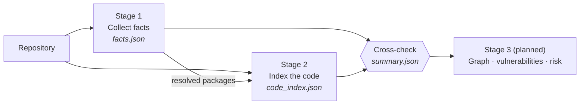

# Software Supply Chain Guardian

> *Know what you build. Trust what you ship.*

**Continuous supply-chain analysis for Python repositories: deterministic facts, a code-level index, and the context that tells you which findings actually matter.**


---

## What it does

Most scanners tell you **what is present**. Guardian first works out **what your application is and how it uses what it has**, then hands that evidence to the later stages (graph, vulnerabilities, risk, remediation).



| Stage | Question it answers | Method | Status |
|---|---|---|---|
| **1. Fact collection** | What is declared, resolved, shipped and changed? | Deterministic parsers, optional Syft + PyPI | Built |
| **2. Code index** | What does the code import, call, expose and read? | Python `ast` only, nothing is executed | Built |
| **Cross-check** | Where do the two disagree? (declared but never imported, imported but never declared) | Set comparison on normalised package names | Built |
| 3. Knowledge, graph, risk | Which findings matter, and what is the blast radius? | Graph + evidence-checked analysis | Planned |

**Ground rules:** Python repositories only · the target repository's code is never executed · collectors record facts and never judge · every fact carries a file and line · one broken file or network error never stops a scan (it lands in `errors[]`).

---

## Features

### Stage 1: Fact collection
| Feature | Details |
|---|---|
| **Declared dependencies** | `requirements*.txt`, `pyproject.toml`, `setup.cfg`, `Pipfile`; follows `-r`/`-c` includes; classifies registry / VCS / URL / local; flags dev dependencies; records package-index settings |
| **Resolution** | `poetry.lock`, `Pipfile.lock`, `uv.lock`, otherwise an isolated `pip install --dry-run --only-binary=:all:` report (optional `--docker`) |
| **SBOM** | CycloneDX JSON via Syft, cross-checked against the resolved packages |
| **PyPI metadata** | Upload date, first release, release count, maintainers, project URLs, yanked, sdist-only, hashes (disk-cached) |
| **CI/CD** | GitHub Actions triggers, permissions, actions with `pinned_to_sha`, run steps, secrets referenced |
| **Containers** | Dockerfile base images, tags, digests, pip installs, remote `curl`/`wget` fetches |
| **History / time travel** | Dependency-file commits with `added` / `removed` / `changed` package diffs, snapshots at any commit without a checkout |
| **Configuration** | `.env*` variable **names only** (no secrets), `docker-compose*.yml` services, migration folders |

### Stage 2: Code index
| Feature | Details |
|---|---|
| **Imports** | internal / external / stdlib, relative imports resolved, `try/except` and conditional flags, script-style sibling imports, PyPI distribution for each external import |
| **Definitions** | functions, async functions, classes, methods with ids like `app/payments/client.py::get_client`, decorators, parameters, line ranges |
| **Calls** | alias-resolved (`import yaml as y; y.load(x)` becomes `yaml.load`), attributed to the calling function: function-level package usage |
| **Sensitive calls** | `network` · `subprocess` · `code_exec` · `deserialize` · `file_write` · `crypto` (`yaml.safe_load` and `Loader=SafeLoader` are *not* flagged) |
| **Routes** | Flask and FastAPI decorators, Django `urls.py` (`path` / `re_path` / `include`) |
| **Environment** | `os.environ[...]`, `os.environ.get`, `os.getenv` reads (assignments are not reads) |
| **Other** | CLI entry points (click, typer, argparse, `__main__`), URL strings, dynamic imports recorded as *known unknowns* |
| **Robustness** | never follows symlinks or junctions, survives syntax errors, huge or unreadable files and very deep expressions, caches unchanged files by SHA-256 |

---

## Installation

**Prerequisites:** Python **3.11+** (tested on 3.12; Stage 1 needs `tomllib`) and Git. Optional: [Syft](https://github.com/anchore/syft) for SBOMs, Docker for isolated resolution.

<details open>
<summary><b>Linux / macOS</b></summary>

```bash
git clone <repo-url> && cd <repo-folder>
python3 -m venv .venv && source .venv/bin/activate
pip install --upgrade pip
pip install -e ".[dev]"          # or: pip install -r requirements-dev.txt
```
</details>

<details>
<summary><b>Windows (PowerShell)</b></summary>

```powershell
python -m venv .venv
.venv\Scripts\Activate.ps1
python -m pip install --upgrade pip
python -m pip install -e ".[dev]"
```
</details>

<details>
<summary><b>Windows (CMD)</b></summary>

```cmd
python -m venv .venv
.venv\Scripts\activate.bat
python -m pip install --upgrade pip
python -m pip install -e ".[dev]"
```
</details>

---

## Usage

| Command | What it runs | Writes |
|---|---|---|
| `guardian scan <repo>` | Stage 1 **and** Stage 2, linked | `facts.json`, `code_index.json`, `summary.json`, `sbom.cdx.json` (with Syft) |
| `guardian index <repo>` | Stage 2 only | `code_index.json` |

```bash
guardian scan path/to/repo                       # standard scan
guardian scan path/to/repo --out output/my-repo  # choose the output folder (-o / --output also work)
guardian scan path/to/repo --docker              # resolve dependencies inside Docker (recommended for untrusted repos)
guardian scan path/to/repo --offline             # skip PyPI network calls
guardian scan path/to/repo --skip-sbom           # no Syft

guardian index path/to/repo --facts output/my-repo/facts.json   # Stage 2 alone, reusing Stage 1's resolved packages
```

Without installing, from a checkout: `PYTHONPATH=src python -m guardian.cli scan path/to/repo`.

### Example (real output on the `mini-shop` test fixture)
```text
mini-shop: stage 1 -> 7 declared, 18 resolved, 1 workflows, 1 dockerfiles, 0 stage-1 warnings
mini-shop: stage 2 -> 8 files, 1 routes, 2 sensitive calls, 0 errors
mini-shop: declared but never imported: ['colorama', 'sqlalchemy']; imported but not declared: none
output: output/mini-shop
```

### Outputs
| File | Contents |
|---|---|
| `facts.json` | Stage 1: declared and resolved dependencies, indexes, PyPI metadata, CI, containers, history, docs, config, file hashes |
| `code_index.json` | Stage 2: per file imports, definitions, calls, sensitive calls, routes, env reads, entry points, URLs, dynamic imports |
| `sbom.cdx.json` | CycloneDX SBOM (Syft) |
| `summary.json` | Cross-check: `declared_not_imported`, `imported_not_declared`, `dynamic_imports_present` |

---

## Project layout

```text
src/guardian/
  cli.py                  scan · index
  adapters.py             facts + code index -> graph inputs, declared-vs-used cross-check
  models/                 Pydantic contracts (facts.py, code_index.py, common.py)
  stage1_facts/           manifests · resolver · sbom · pypi_meta · cicd · docker · git_history · docs · config
  stage2_code/            parser · visitors · pattern_visitor · import_resolver · dist_map · patterns
tests/                    unit, regression, golden-syntax and end-to-end tests
docs/                     design, implementation plan, Stage 2 handoff
```

---

## Honest limits

- **Informational cross-check:** a dependency that is declared but never imported may be loaded dynamically or by a plugin. Dynamic imports are flagged, never guessed. Flat pin files also list transitive packages, so the list can be noisy when `requires` data is missing.
- **Static only:** an import shows a package is *referenced*, not that it runs. Calls on objects of unknown type (`self.client.send()`) are intentionally not recorded.
- **Routes:** OpenAPI/connexion routes (declared in YAML) are not detected.
- **Stage 1 gaps:** compose volumes (for example a `docker.sock` mount), container `USER` and exposed ports are not captured yet. When the pip report fails, resolved packages have no `requires`, so there are no dependency edges.
- **Platforms:** developed and tested on Windows; Linux and macOS are not yet verified. Syft was not available when this was tested, so SBOM generation is untested here.
- **Accuracy:** 21 randomly sampled facts from a real repository (PyGoat) were checked against the source and all matched. That is a spot check, not a measured accuracy rate.

---

## Running the tests

```bash
pytest tests/ -v                       # Windows: pytest tests\ -v
```

The real-repository runs are skipped unless you point `GUARDIAN_TEST_REPOS` at a folder containing shallow clones of `pygoat`, `VAmPI`, `vulpy` and `shiftleft-python-demo`:

```bash
GUARDIAN_TEST_REPOS=/path/to/clones pytest tests/ -v          # PowerShell: $env:GUARDIAN_TEST_REPOS = "C:\path\to\clones"
```

Last full run: **115 passed** (with the real repositories present).

---

## Responsible use

Guardian analyses repositories you are authorised to scan. It parses source code without executing it, runs dependency resolution with `--only-binary=:all:` (optionally inside Docker) so package build scripts do not run, and never records secret values (environment files contribute variable names only).
